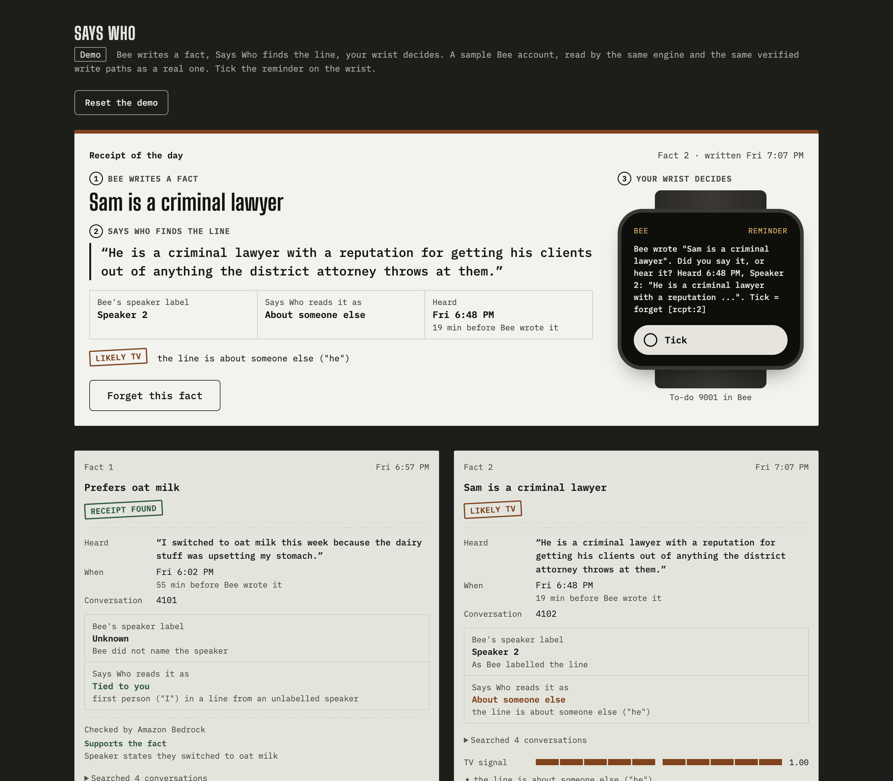

# Says Who

**Bee writes a fact, Says Who finds the line, your wrist decides.**



```bash
npm i && npm run demo      # http://127.0.0.1:8790/demo, no Bee login needed: tick the reminder on the wrist
```

Bee writes facts about you from everything its microphone hears, including the TV. Says Who gives every one of those facts a receipt: the exact line Bee heard that matches it, who said it, when and how long before Bee wrote the fact, and a TV signal with every cue listed. The doubtful ones reach your wrist as a Bee reminder. Tick it and the fact is gone from Bee, read back to prove it. When a match is close but not conclusive, Amazon Bedrock reads the line and the receipt prints "Checked by Amazon Bedrock".

## How it works

1. `says-who watch` reads the `bee changed` cursor every 60 seconds and saves the cursor only after the batch is processed.
2. Each new fact is searched against conversations: BM25 first, the most recent conversations next, neural search only when those find nothing. Candidates are re-read through `conversations get` and matched on **utterances**. When two conversations hold an equally good line, the one spoken closest to when Bee wrote the fact wins, and the receipt prints the gap ("19 min before Bee wrote it"). Bee's AI-written summaries are never evidence and never quoted.
3. The verdict is one of `supported`, `likely-tv`, `unattributed` (a line matches the words but nothing ties it to the wearer), `no-evidence`, `duplicate` (the same claim as an older stored fact) or `contradicts` (opposes a fact the wearer confirmed). `supported` needs attribution: a wearer label or first-person wording, so "my brother is vegan" never supports "is vegan". `Unknown` speaker labels count as unknown attribution, never as the wearer. Negation is read per clause, so "does not like oat milk" is never supported by "I switched to oat milk". The TV signal adds up named cues (who spoke the line, other voices, scripted cadence, show and podcast cues, third person) and the receipt prints each one. `likely-tv` needs a cue on the line itself, so the wearer's own sentence inside a TV-like room stays `supported`. Every receipt shows exactly where Says Who looked: the conversations read, their times, the search window and the method. `no-evidence` names that list.
4. Every verdict except `supported` becomes a Bee reminder with `alarm_at` set to now, phrased as a question ("Did you say it, or hear it?") over the matching line, or for `no-evidence` the number of conversations searched. The fact id rides in the reminder text as `[rcpt:<id>]`. The review page shows that reminder, word for word, on a watch face beside the receipt.
5. A stream wake-up on the reminder-updated event, plus a poll, finds the ticked reminder. Says Who runs `facts delete`, then `facts get` and only records the decision when Bee answers not found.
6. Facts the wearer already confirmed get a receipt and no reminder. Supported facts are confirmed from the review page, with a read-back on `confirmed`.

Every receipt is stored in a local SQLite ledger (fact id, verdict, 25-word quote, speaker, time, TV score, decision), which keeps the evidence after Bee's history window and after Bee deletes short recordings.

## Run it

```bash
npm install
npx bee login --no-wait          # approve the link in the Bee app, then: npx bee me
npm run doctor                   # account, confirmed and pending fact counts
npm run watch                    # loop + review page on http://127.0.0.1:8790
npm run why "criminal lawyer"    # receipt for one stored fact
npm run why -- --demo "criminal lawyer"   # the same on the sample account, no Bee login
npm run report                   # provenance counts and the wearer's decisions
npm run report -- --demo --md    # markdown self-review: questionable facts before and now, each with its quote
npm run demo                     # a sample account at http://127.0.0.1:8790/demo, no Bee login; four receipts with a Bedrock key
npm run receipt 12               # the stored receipt for fact 12 as JSON
npm run demo-day                 # the live procedure: TV clip near the Watch, receipt, wrist tick, read-back
```

The review page opens with the receipt of the day: the most doubtful fact Bee wrote, the exact line behind it, Bee's own speaker label beside what Says Who reads from the words, the time, the verdict and one action. `/demo` shows a supported fact, a heard-on-TV fact and a no-evidence fact side by side, plus, with `AWS_BEARER_TOKEN_BEDROCK` set, a jazz fact only Amazon Bedrock can receipt. The receipt of the day carries the wrist: its Tick button completes the to-do in the sample Bee, the live loop's own reconcile path deletes the fact and reads it back, and the next reminder takes its place. Forget and Confirm work the same way, with read-backs.

`scripts/demo-day.md` is the demo-day procedure and `scripts/record-demo.sh` runs it end to end with the screen recording and the logs filed under `recordings/`. `scripts/forced-fault.sh` drives it with the real `bee` CLI: it starts once `bee me` confirms the login, waits for Bee itself to write a fact after the clip, prints the receipt, reads the wrist reminder back from Bee, waits for the tick and checks that `bee facts get` answers not found.

Environment: `RECEIPTS_DB` (default `.receipts/ledger.db`), `RECEIPTS_PORT` (8790), `RECEIPTS_INTERVAL_S` (60), `RECEIPTS_WEARER_SPEAKERS` (speaker labels that mean the wearer, default `you,me,user,owner,wearer`; add `unknown` only if your device labels you so), `RECEIPTS_SHOW_NAMES` (extra show cues, comma separated), `BEE_BIN` (path to a different `bee`).

## Agent Skill

`skills/receipts/SKILL.md` (bundled as `skills/receipts.skill`, the same single-entry zip format as `bee-computer/bee-skill`) teaches Claude Code or any skills-capable agent to answer "why does Bee think I'm a lawyer?" with the receipt: verbatim quote, speaker, time, TV score, verdict. It also carries the same check as plain bee-cli commands for machines without this repo. A test ties the skill to the code: every command, verdict and receipt field it names must exist.

## Bee surfaces called

`createBeeClient` from `@beeai/cli/lib` drives `me`, `changed --cursor`, `facts list/get/confirm/delete`, `search` (BM25 and `--neural`), `conversations list/get`, reminder create with `--alarm-at`, get and list, and `stream --types` for reminder updates. File and line references are in `NOTES.md`.

## Proof

- `npm test` runs 100 tests on labeled fixtures whose payload shapes are copied from the bee-cli source, including the real client calling the bundled `bee` binary and a full `says-who once` pass through a spawned `bee` process.
- Must-fail cases: a planted fact no utterance supports comes back `no-evidence` even when search returns every conversation; a line that shares the fact's keywords but is about someone else comes back `unattributed`; the wearer's own sentence inside a TV-like conversation is not marked `likely-tv`; an unticked reminder produces no delete.
- Amazon Bedrock is the tie-breaker for borderline matches whenever `AWS_BEARER_TOKEN_BEDROCK` is set: `openai.gpt-oss-120b` through the Bedrock OpenAI-compatible endpoint (`RECEIPTS_JUDGE=none` turns it off). Its verdict prints on the receipt as "Checked by Amazon Bedrock". In the keyed demo it receipts "Enjoys jazz" from "Jazz records are all I play in the evenings.", a paraphrase word matching cannot prove. A judge error never changes a verdict; the live tests in `test/judge.test.ts` and `test/demo.test.ts` make real calls.
- `npm run mutation` breaks the guarded code 35 ways (matcher always hits, forget without a tick, TV signal removed, cursor handling, search scope, attribution, the line-level TV rule, Unknown speaker handling, the live feed, the demo-day login gate and more), requires red each time, restores, and requires green.
- `npm run viewport-check` frames the review page at 320, 390 and 1440 px in a browser tab and fails on horizontal scroll, clipped text, a stamp over heading text, small tap targets or broken-mid-word labels. A control run with deliberately broken CSS must fail or the check itself fails.
- `npm run live-check` runs the three device spikes against the logged-in account and prints measured numbers. It exits 2 when logged out and 3 when the account has no facts.

MIT licensed.
